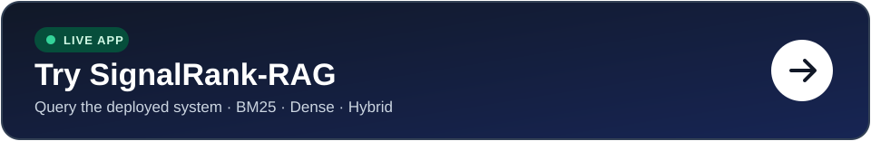
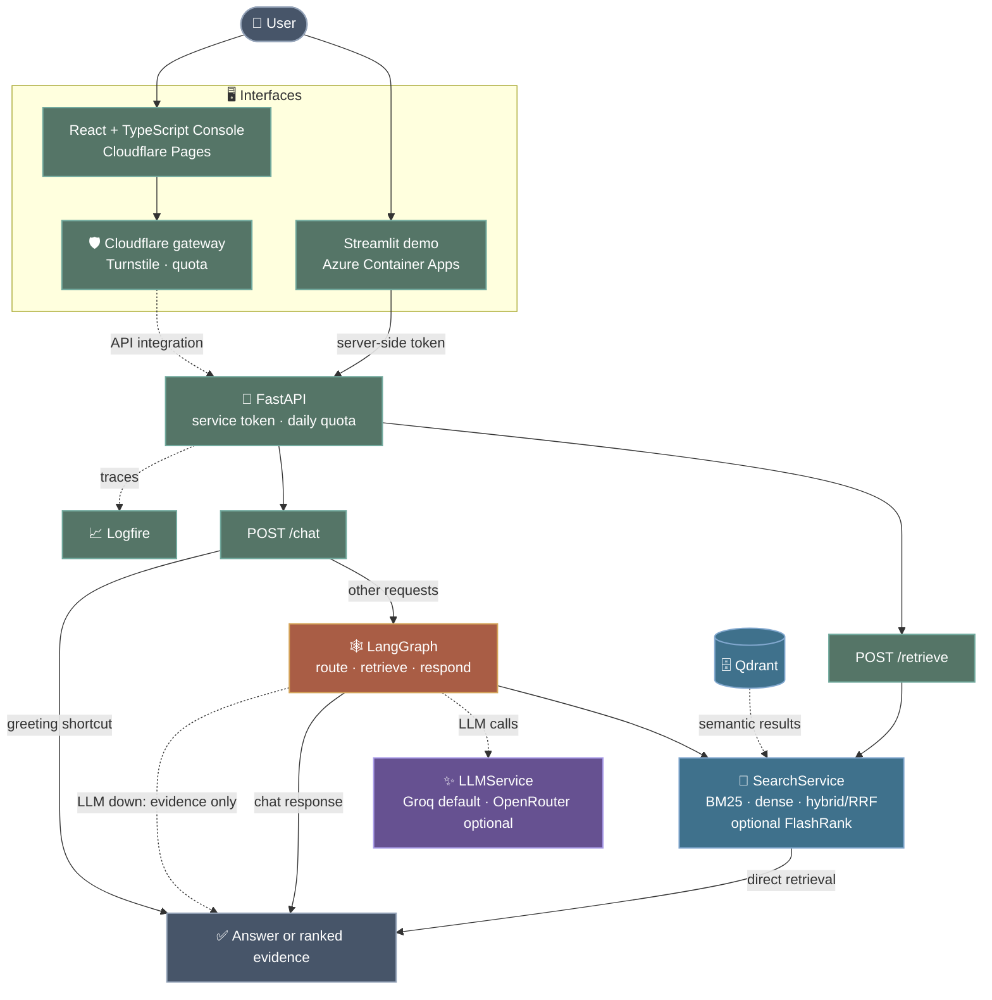
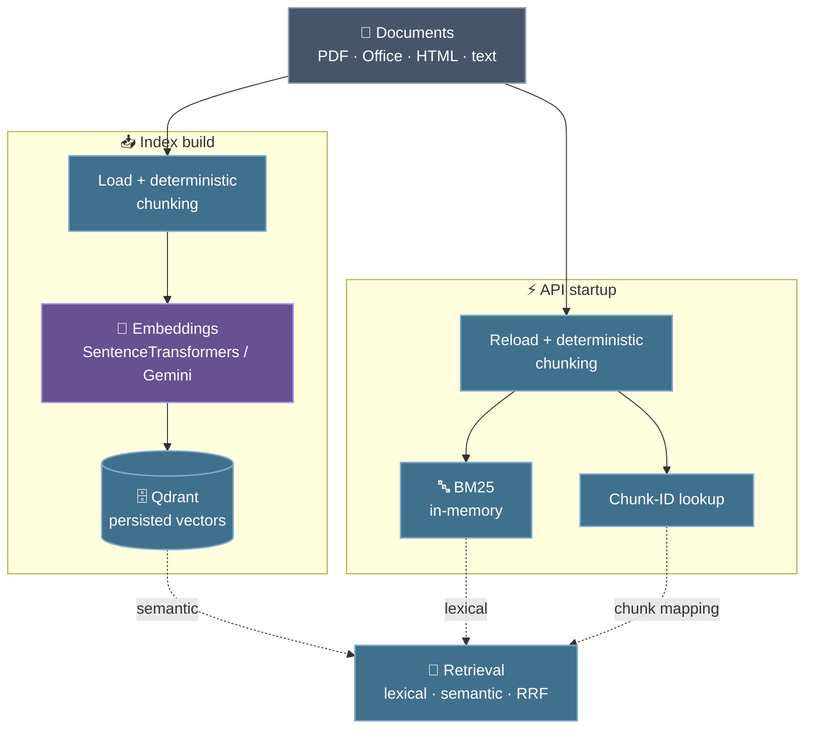
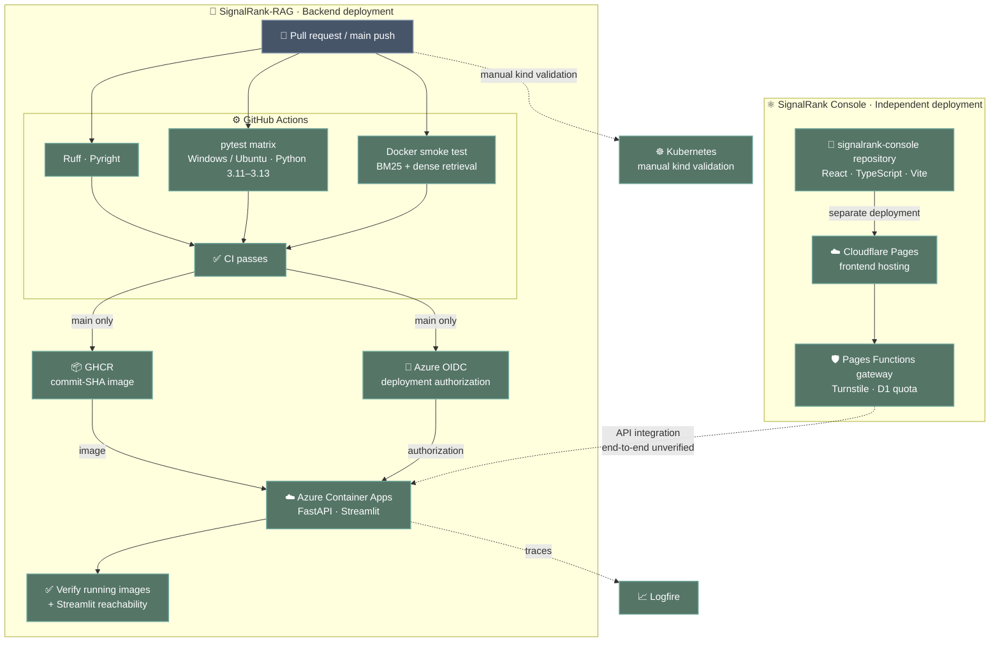
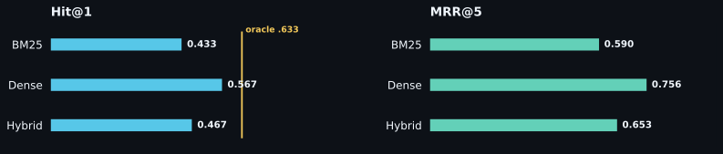

<p align="center">
  <a href="https://signalrank-ui.icybeach-127c89e3.northeurope.azurecontainerapps.io">
    
  </a>
</p>

# SignalRank-RAG

**Reproducible retrieval, reranking, and grounded responses.**

SignalRank-RAG is an open-source RAG application built with **Python, FastAPI, LangGraph, and Qdrant**. It combines deterministic ingestion, hybrid retrieval, optional FlashRank reranking, evidence-backed generation, and automated cloud deployment.

[](https://github.com/bksampadi/SignalRank-RAG/actions/workflows/ci_cd.yml)

[](https://github.com/bksampadi/signalrank-console)
[](https://github.com/bksampadi/SignalRank-RAG/releases)


[](https://github.com/bksampadi/signalrank-console)

The live **Streamlit demo** exposes BM25, dense, and hybrid retrieval with inspectable evidence and relevance feedback. A separate **[React/TypeScript Console](https://github.com/bksampadi/signalrank-console)** provides a Cloudflare Pages frontend and gateway.

---

## System Architecture

<p align="center">
  
  
  
  
</p>

Three views show distinct lifecycles: **request processing**, **corpus/index preparation**, and **delivery/runtime**. Colors indicate engineering responsibilities across all three.

### 1. Request processing



`/retrieve` invokes `SearchService` directly; `/chat` uses LangGraph for conversation, grounded synthesis, or evidence-only responses. Both reuse the same retrieval and optional reranking pipeline. Common greetings bypass the graph.

| `/chat` mode | Behaviour |
| --- | --- |
| `auto` | Structured LLM routing between conversation and retrieval |
| `synthesis` | Retrieve and generate a grounded answer |
| `evidence` | Return ranked evidence without LLM synthesis |

**Reliability:** The responder abstains when evidence is insufficient. Router failures fall back to retrieval and the evidence responder; generation failures return evidence without further synthesis. Groq is the default configured provider, with OpenRouter as an alternative—not automatic cross-provider failover.

**Security:** `/chat` and `/retrieve` use `X-SignalRank-Service-Token` and share an **in-process limit of 100 requests per UTC day per process** (HTTP 429). The counter resets on restart; it is not distributed. `/health` is unauthenticated, and browser code never receives the service token. The **dashed gateway-to-API link** denotes integration whose live end-to-end success has not yet been confirmed.

### 2. Corpus and index lifecycle



`scripts/index_corpus.py` persists embeddings in Qdrant. At API startup, BM25 and the chunk lookup are rebuilt from the same deterministically chunked corpus; `recreate_collection` can also trigger reindexing. Hybrid retrieval fuses BM25 and dense rankings with reciprocal rank fusion (RRF).

### 3. Delivery and runtime



**Two independent deployments:** SignalRank-RAG runs CI and publishes SHA-tagged images to GHCR before OIDC-based deployment to Azure Container Apps. The [React/TypeScript Console](https://github.com/bksampadi/signalrank-console) is deployed separately on Cloudflare Pages, with Pages Functions for Turnstile validation and quota enforcement. The Cloudflare-to-Azure API connection remains dashed until verified end to end. Kubernetes manifests are validated manually with `kind`, not deployed to production.

---

## Project Structure

```text
SignalRank-RAG/
├── .github/workflows/       # CI/CD
├── benchmarks/retrieval/    # corpus, queries, ground truth
├── configs/                 # application and benchmark settings
├── deploy/kubernetes/       # kind-validated runtime manifests
├── scripts/                 # indexing, benchmarking, local demo
├── src/signalrank/
│   ├── agents/              # LangGraph routing and responders
│   ├── api/                 # FastAPI endpoints and request checks
│   ├── components/          # loaders, chunking, embeddings, retrieval, ranking
│   ├── config/              # typed YAML configuration
│   ├── evaluation/          # retrieval metrics
│   ├── observability/       # Logfire integration
│   ├── pipelines/           # indexing and retrieval orchestration
│   ├── security/            # request quota and protection
│   ├── services/            # search and LLM service boundaries
│   └── ui/                  # Streamlit and feedback
├── tests/
├── compose.yaml
├── Dockerfile
├── pyproject.toml
└── uv.lock
```

---

## Retrieval and Reranking

- **BM25:** Lexical matching for exact terms.
- **Dense:** Semantic retrieval using embeddings in Qdrant.
- **Hybrid:** Reciprocal rank fusion of lexical and dense rankings.
- **FlashRank:** Optional second-stage reranking of retrieved candidates.

Retrieval determines the candidate set; reranking reorders it. Both are exposed through replaceable service boundaries.

### Adversarial retrieval benchmark

The reproducible benchmark contains **39 documents and 30 labelled queries**. Results measure **first-stage retrieval**, before reranking or answer generation.

<p align="center">
  
</p>

| Mode | Hit@1 | MRR@5 |
| --- | ---: | ---: |
| BM25 | 0.433 | 0.590 |
| Dense | **0.567** | **0.756** |
| Hybrid (RRF) | 0.467 | 0.653 |

Dense retrieval achieves **Hit@5 = 1.000** on this corpus, but BM25 finds top-1 matches dense retrieval misses (`BM25 only: 2`; `dense only: 6`). Their top-1 oracle reaches **0.633**; baseline hybrid fusion still underperforms dense retrieval. This motivates better fusion and reranking rather than assuming hybrid search must win.

<details>
<summary><strong>Reproduce the benchmark</strong></summary>

```bash
uv sync --extra eval
uv run --locked python scripts/index_corpus.py --config configs/benchmark.yaml --recreate
uv run --locked python scripts/benchmark_retrieval.py
```

The benchmark configuration pins the `sentence-transformers/all-mpnet-base-v2` model, corpus, chunking, and retrieval settings. The model must be available locally or downloaded on first use.

</details>

---

## API

| Endpoint | Purpose | Authentication |
| --- | --- | --- |
| `GET /health` | Liveness check | None |
| `POST /retrieve` | BM25, dense, or hybrid results; optional reranking | Service token |
| `POST /chat` | Routing, grounded synthesis, or evidence-only response | Service token |

`/chat` supports `auto`, `synthesis`, and `evidence` response modes. The API accepts `X-SignalRank-Service-Token` for protected endpoints.

```bash
curl -X POST http://127.0.0.1:8000/chat \
  -H "Content-Type: application/json" \
  -H "X-SignalRank-Service-Token: signalrank-local-dev" \
  -d '{"query":"What caused the extinction of the dinosaurs?","mode":"hybrid","top_k":5}'
```

The example token is for local development; production credentials must be supplied through secrets.

---

## Quick Start

```bash
docker compose up --build
```

- **Streamlit:** http://localhost:8501
- **FastAPI docs:** http://localhost:8000/docs
- **Health check:** http://localhost:8000/health

For the benchmark-backed local demo on Windows:

```cmd
scripts\run_demo.cmd
```

<details>
<summary><strong>Development and configuration</strong></summary>

The project uses [`uv`](https://docs.astral.sh/uv/) with a committed lockfile.

```bash
uv sync --extra eval
uv run --locked python -m pytest -v
uv run --locked ruff check .
uv run --locked ruff format --check .
uv run --locked pyright
```

Run the services directly:

```bash
uv run uvicorn signalrank.api.main:app --reload
uv run streamlit run src/signalrank/ui/app.py
```

YAML configuration covers ingestion, embeddings, retrieval, fusion, reranking, Qdrant, response modes, and LLM providers. Qdrant supports in-memory, local, or remote operation. Deployment credentials come from environment variables or managed secrets, not committed configuration.

Common environment variables:

```text
GROQ_API_KEY
GEMINI_API_KEY
OPENROUTER_API_KEY
QDRANT_URL
QDRANT_API_KEY
LOGFIRE_TOKEN
SIGNALRANK_API_URL
SIGNALRANK_SERVICE_TOKEN
```

</details>

---

## Evaluation and Observability

The Streamlit UI collects **Relevant / Not relevant** judgements with query and result metadata for offline retrieval diagnostics. Feedback does not change rankings online.

**Logfire** traces API requests, retrieval, embeddings, reranking, routing, LLM calls, provider failures, and feedback events. Some evaluation logs may include submitted queries or result metadata; do not enter sensitive information into the public demo. Logfire is optional locally.

---

## Deployment and Kubernetes

**Backend:** GitHub Actions publishes commit-SHA images to GHCR, deploys to Azure using OIDC, and verifies both Container Apps. Secrets are injected at runtime.

**Frontend:** The separate [SignalRank Console](https://github.com/bksampadi/signalrank-console) repository deploys React/TypeScript assets and a Pages Functions gateway to Cloudflare Pages. Its protected API path requires end-to-end verification.

Kubernetes configuration under [`deploy/kubernetes`](deploy/kubernetes) is validated locally with `kind`. It includes a Deployment, ClusterIP Service, startup/readiness/liveness probes, resource limits, HorizontalPodAutoscaler, Secrets, ConfigMaps, and Kustomize. Azure Container Apps remains the deployed runtime.

---

## Roadmap

**Implemented:** Deterministic ingestion; BM25, dense, and hybrid retrieval; optional FlashRank reranking; LangGraph routing, evidence-only fallback, and basic abstention; adversarial evaluation; relevance feedback; API token/quota; Azure CI/CD; Cloudflare Pages Console deployment; kind-validated Kubernetes manifests.

**Next:** Reranker benchmarks and ranking diagnostics; improved fusion; stronger evidence-sufficiency and abstention calibration; larger retrieval benchmarks; retrieval-quality gates in CI; richer routing policies.

---

## Cite

```bibtex
@software{signalrank_rag,
  author = {Bharath Sampadi},
  title = {SignalRank-RAG: Reproducible Retrieval, Reranking, and Grounded Responses},
  year = {2026},
  publisher = {GitHub},
  url = {https://github.com/bksampadi/SignalRank-RAG}
}
```

## License

MIT License. See [`LICENSE`](LICENSE).
